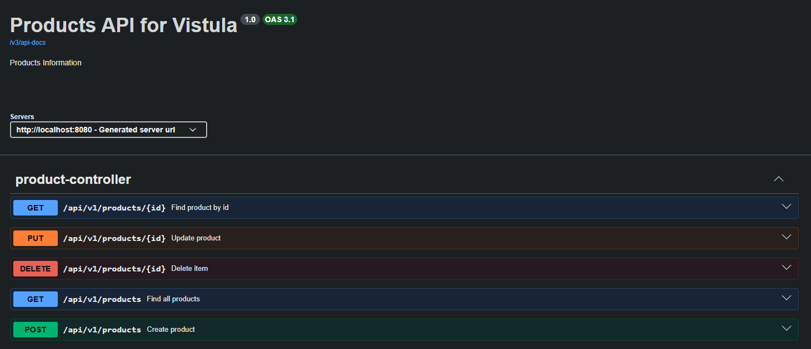
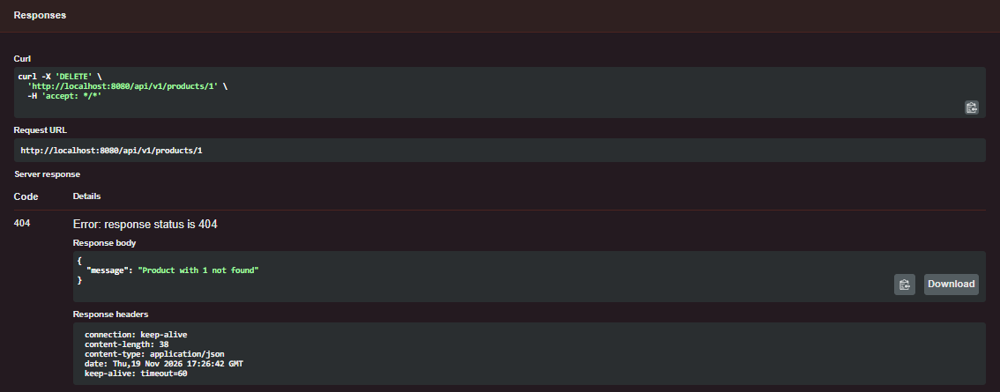
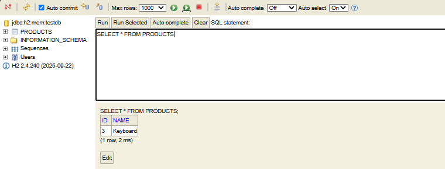

# FirstRestAPI

Task 2 for the Java course at Vistula University.
Author: Danylo Kholodtsov, 76822

## About

FirstRestAPI is a simple REST API for managing products, built with Spring Boot. It supports the four basic operations (create, read, update, delete). Each product has an `id`, which the database generates, and a `name`.

The data is stored in an H2 in-memory database. The database is created when the app starts and cleared when it stops, so every run starts with an empty product list.



## Technologies

- Java 17
- Spring Boot 4.1.2 (Spring Web)
- Spring Data JPA
- H2 in-memory database
- springdoc OpenAPI (Swagger UI)
- Maven (with the Maven wrapper, so Maven does not need to be installed)

## Project structure

The code is split into layers, each in its own package under `org.example.firstrestapi.product`:

| Package | What it contains |
|---|---|
| `api` | `ProductController`, which receives HTTP requests, plus the request and response classes (DTOs) |
| `service` | `ProductService`, which holds the business logic |
| `repository` | `ProductRepository`, a Spring Data `JpaRepository` that talks to the database |
| `domain` | `Product`, the JPA entity saved in the `products` table |
| `support` | `ProductMapper` (converts between entity and DTOs) and exception handling |

A request goes through the layers like this: Controller → Service → Repository → H2 database. The controller never returns the entity directly; it always returns a `ProductResponse`.

## How to run

1. Make sure Java 17 or newer is installed (`java -version`).
2. Open a terminal in the project folder.
3. Start the app with the Maven wrapper:

```
mvnw.cmd spring-boot:run
```

On Linux or macOS use `./mvnw spring-boot:run` instead. You can also open the project in IntelliJ IDEA and run the `FirstRestApiApplication` class.

The app starts on http://localhost:8080. Note that the root address itself shows an error page, because the API has no page there. Use the links below.

## Endpoints

All endpoints are under `/api/v1/products`.

| Method | URL | Description | Success status |
|---|---|---|---|
| POST | `/api/v1/products` | Create a new product | 201 Created |
| GET | `/api/v1/products` | Get all products | 200 OK |
| GET | `/api/v1/products/{id}` | Get one product by id | 200 OK |
| PUT | `/api/v1/products/{id}` | Change the name of a product | 200 OK |
| DELETE | `/api/v1/products/{id}` | Delete a product | 204 No Content |

## How to use

The easiest way to try the API is Swagger UI at http://localhost:8080/swagger-ui/index.html. Click an endpoint, then "Try it out", fill in the fields and click "Execute".

### Create a product

Send a POST request with the product name:

```json
{ "name": "Laptop" }
```

The API returns the saved product with its new id and status 201:

```json
{ "id": 1, "name": "Laptop" }
```


### Get all products

A GET request to `/api/v1/products` returns a list of all saved products. If there are none, it returns an empty list `[]`.


### Get a product by id

A GET request to `/api/v1/products/1` returns the product with id 1.


### Update a product

A PUT request to `/api/v1/products/1` with a new name changes the product and returns the updated version:

```json
{ "name": "Gaming laptop" }
```


### Delete a product

A DELETE request to `/api/v1/products/1` removes the product. The response has status 204 and no body.


### Error handling

If a product with the given id does not exist (for GET, PUT or DELETE), the API returns status 404 with a message:

```json
{ "message": "Product with 999 not found" }
```

This is handled by `ProductExceptionAdvisor`, which catches `ProductNotFoundException` and turns it into a clean JSON response instead of a stack trace.



## H2 database console

You can look inside the database while the app is running at http://localhost:8080/console.

1. Set **JDBC URL** to `jdbc:h2:mem:testdb`.
2. Leave the user name as `sa` and the password empty, then click **Connect**.
3. Run `SELECT * FROM PRODUCTS;` to see the saved products.


