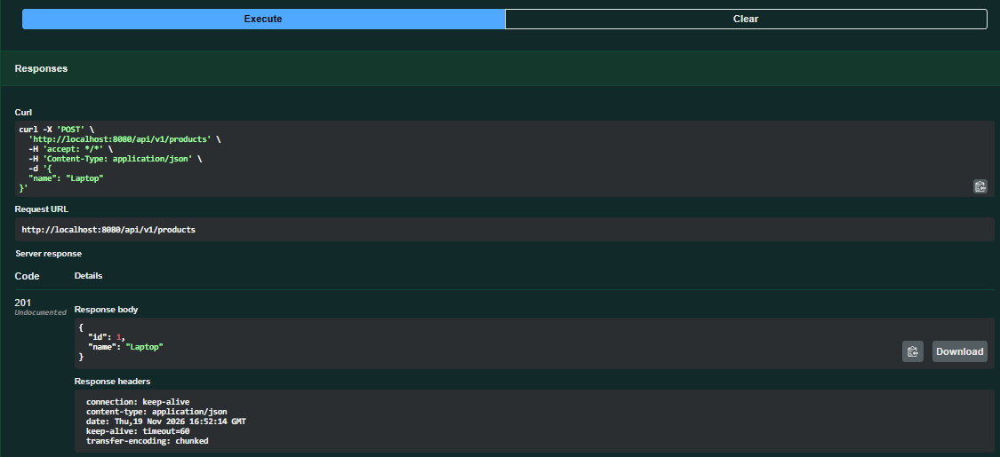
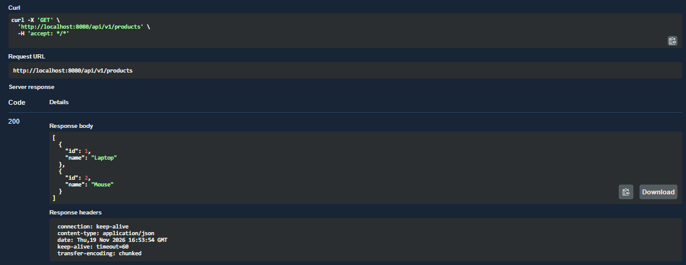
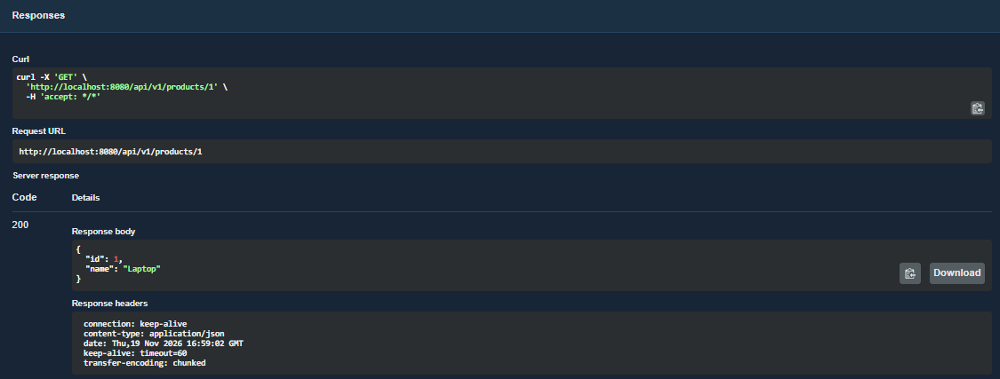
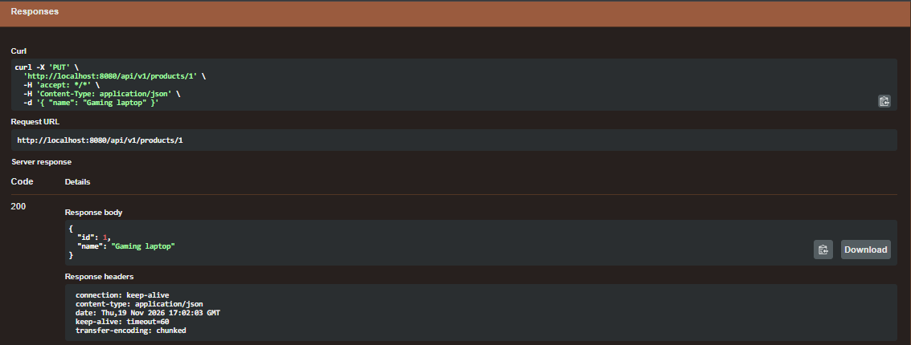
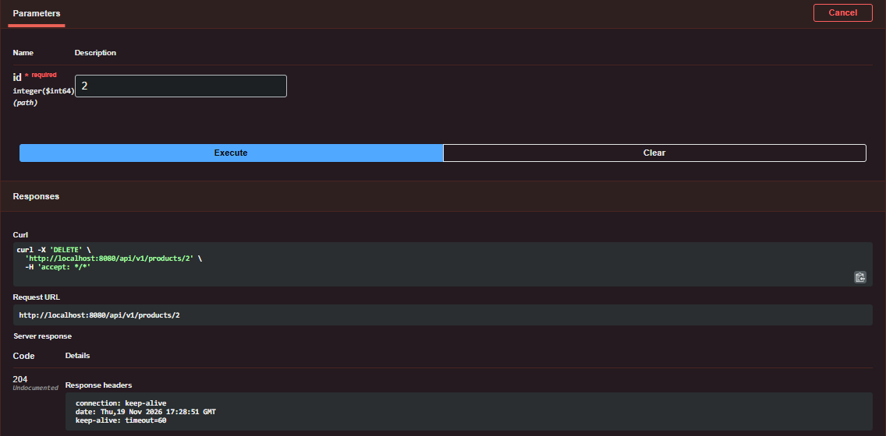

# FirstRestAPI

Task 2 for the Java course at Vistula University.
Author: Danylo Kholodtsov, 76822

## About

This is a simple REST API for products, made with Spring Boot. You can create, read, update and delete products. Each product has an id and a name. The id is generated by the database.

The data is saved in an H2 in-memory database, so it is cleared every time the app is restarted.

The project uses Java 17, Spring Boot 4.1.2, Spring Data JPA, H2 and Swagger (springdoc).


## How it works

The code is split into a few packages. ProductController gets the requests, ProductService has the logic, and ProductRepository saves products to the database. Product is the entity class. ProductMapper changes a Product into a ProductResponse, so the controller doesn't return the entity directly.

## How to run

Start the app with the Maven wrapper:

```
mvnw.cmd spring-boot:run
```

On Linux or macOS use ./mvnw spring-boot:run instead. You can also run the FirstRestApiApplication class from IntelliJ IDEA.

The app starts on http://localhost:8080. There is no page on the main address, so go to Swagger UI instead: http://localhost:8080/swagger-ui/index.html

## How to use

All endpoints are under /api/v1/products. I tested all of them in Swagger UI, the screenshots are below.

### Create a product

POST /api/v1/products creates a new product. Send JSON like {"name": "Laptop"}. It returns the new product with its id and status 201.



### Get all products

GET /api/v1/products returns all products. Here I added Laptop and Mouse first.



### Get one product

GET /api/v1/products/{id} returns one product by its id.



### Update a product

PUT /api/v1/products/{id} changes the name of a product. Send JSON like {"name": "Gaming laptop"}.



### Delete a product

DELETE /api/v1/products/{id} deletes a product. It returns status 204 with no body. Here I deleted the product with id 2.



### Product not found

If a product with the given id does not exist, the API returns 404 with a message. Here I tried to delete product 1 again after it was already deleted, so I got "Product with 1 not found".


## H2 console

You can see the database in the H2 console at http://localhost:8080/console. Use the JDBC URL jdbc:h2:mem:testdb, user sa and no password. Then you can run SELECT * FROM PRODUCTS to see what is saved.


